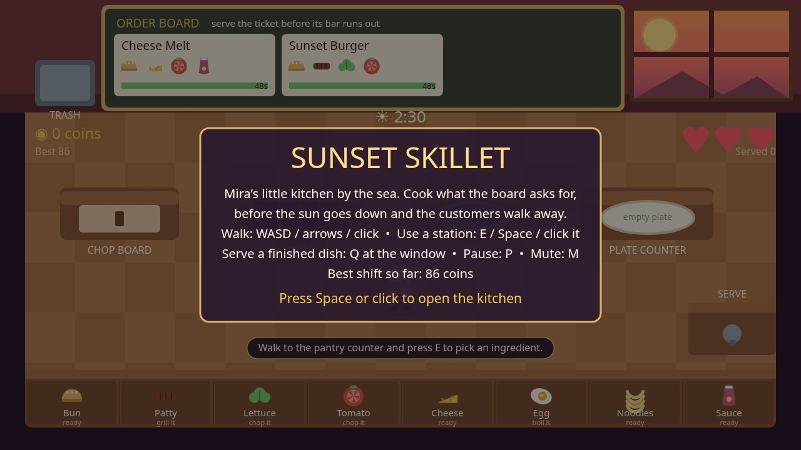
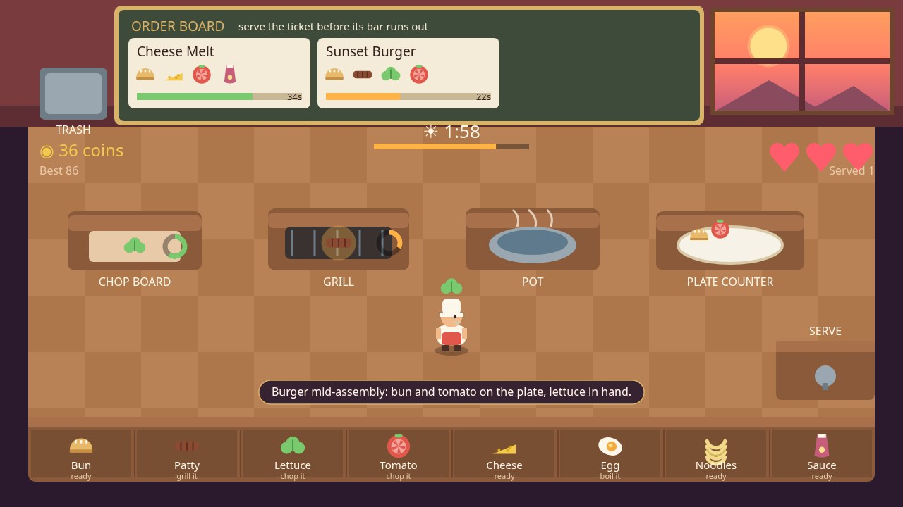
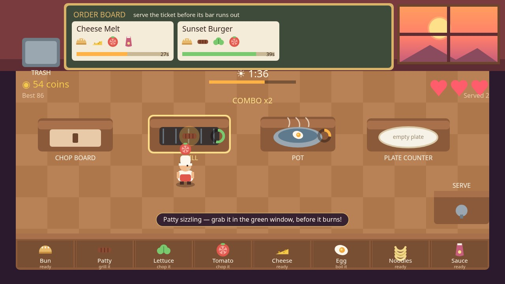
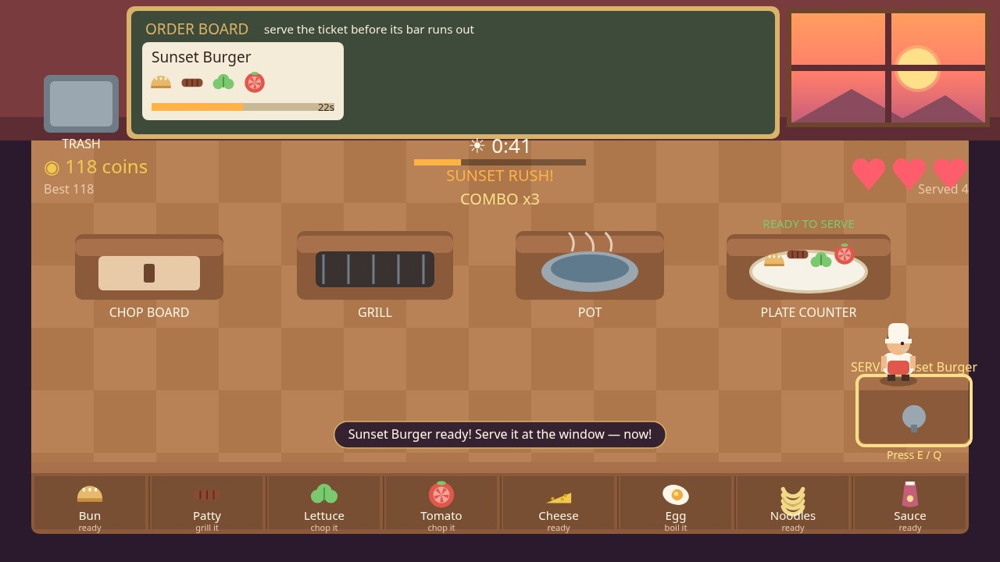

[](https://make.fun/bounty/best-cooking-game-20261125-0137?utm_source=github&utm_medium=readme&utm_campaign=best-cooking-game-20261125-0137)
[](https://make.fun/bounty/best-cooking-game-20261125-0137/leaderboard?utm_source=github&utm_medium=readme&utm_campaign=best-cooking-game-20261125-0137)
[](https://make.fun/bounty/best-cooking-game-20261125-0137?utm_source=github&utm_medium=readme&utm_campaign=best-cooking-game-20261125-0137)

# Sunset Skillet

A complete, original cooking game that runs in a desktop browser with no
build step, no libraries, and no network requests. You run a small kitchen
stall for one 150-second shift: walk the kitchen, prep ingredients, build
the dishes customers order, and serve them before the sun sets — and before
their patience runs out.

This repository is an entry for the make.fun bounty
[“Make the best cooking game”](https://make.fun/bounty/best-cooking-game-20261125-0137).

## How to play

Serve as many orders as you can before the shift clock runs out. Each order
shows the dish a customer wants and how much patience is left. Serve a dish
to earn coins — faster serves earn a bigger tip. An order that expires costs
one of your three reputation hearts; at zero hearts the shift ends early.
Partway through the shift the sunset rush begins: new orders arrive faster
and patience shrinks, so plan routes instead of chasing one order at a time.

A shift lasts 150 seconds, with the rush starting 60 seconds in. Up to
three orders are active at once. Your best score is kept in the browser
(local storage) between visits.

### The kitchen

Walk the chef around a single 1280×720 room with six stations plus a trash
bin:

- **Pantry** (bottom counter) — pick up one of eight ingredients: bun,
  patty, lettuce, tomato, cheese, egg, noodles, sauce. You carry one thing
  at a time.
- **Chopping board** — chop lettuce and tomato (2 seconds each).
- **Grill** — grill a patty. Take it off in the perfect window (about
  4.5 seconds); leave it too long (past about 9.5 seconds) and it burns.
- **Pot** — cook an egg. The perfect window is about 3.5 seconds; past
  about 8 seconds it burns.
- **Plate** — add finished ingredients to the plate, in any order. A dish
  is a set of ingredients, so there is no fixed sequence to memorise.
- **Serve counter** — serve the finished plate to a matching order.
- **Trash** — throw away what you are carrying, or a burnt item.

### The menu

Four dishes, each needing four finished ingredients:

| Dish | Needs | Pay |
| --- | --- | --- |
| Sunset Burger | bun, grilled patty, chopped lettuce, chopped tomato | 30 |
| Garden Bowl | chopped lettuce, chopped tomato, cooked egg, cheese | 26 |
| Golden Noodles | noodles, cooked egg, cheese, sauce | 28 |
| Cheese Melt | bun, cheese, chopped tomato, sauce | 24 |

On top of the dish pay, serving with patience still left earns a tip of up
to 16 extra coins.

## Controls

Keyboard and mouse both work on their own — the whole game is playable
with either.

| Action | Keys |
| --- | --- |
| Walk | `W` `A` `S` `D` or arrow keys |
| Interact (pick up, place, chop, start cooking, take food off) | `E`, `Space`, or `Enter` |
| Serve the plate | `Q` |
| Pause | `P` or `Esc` |
| Mute sound | `M` |

With the mouse, click anywhere to walk there; clicking on a station also
counts as interacting with it. The game announces status changes (orders,
serves, rush) through a screen-reader live region, and the canvas scales
to the browser window.

## Run it locally

You need Node 22. No packages are installed and nothing is built — the
game is plain static files under `game/` (an `index.html` page plus ES
modules), with a tiny standard-library-only static server for local play.

```sh
node serve.ts
```

Then open <http://localhost:8080> in a desktop browser. To use a different
port:

```sh
node serve.ts --port 3000
```

Alternatively, serve the `game/` folder with any static file server and
open `index.html` directly. The game loads fully offline once served.

## Screenshots

The four screenshots in `screenshots/` were captured from the game itself
with a fixed seed, using the built-in staged scenes (`?shot=cover`,
`?shot=grill`, `?shot=serve`, `?shot=title` with `&seed=7` — see
`shots.json`):






## How the code is organised

- `game/index.html` — the page: one full-window canvas plus the
  screen-reader status line. It loads `game/src/main.js`.
- `game/src/main.js` — boot and the fixed-step game loop, the four
  screens (title, play, paused, shift over), sound triggers, and the
  staged screenshot scenes.
- `game/src/kitchen.js` — the rules and state, with no drawing and no
  browser in it: the chef, stations, cooking timers, the plate, orders,
  coins, hearts, and the shift clock.
- `game/src/config.js` — every tuning number, colour, and station
  position in one place.
- `game/src/recipes.js` — the eight ingredients, what prep each needs,
  and the four dishes.
- `game/src/input.js` — keyboard and pointer input.
- `game/src/render.js` — everything drawn on the canvas.
- `game/src/sounds.js` — the Web Audio sound effects.
- `game/src/random.js` — the seeded random stream (so `?seed=N` fixes
  the order stream and a shift can be replayed exactly).
- `game/src/shots.js` — the staged scenes used for screenshots.
- `serve.ts` — the tiny local static server described above.
- `main.ts` — the hand-in program: it copies `game/` and `screenshots/`
  to the output directory and writes `dossier.json`, the summary a judge
  reads, using the vendored helper in `vendor/`. Run it with
  `MAKEFUN_OUTPUT_DIR=out node main.ts` outside the grader's container.
- `vendor/makefun-game.ts` — the vendored make.fun dossier helper.
- `.makefun/owner.json` — the payout wallet for this entry.

## Features

- A full shift loop: orders arrive, patience ticks down, the sunset rush
  raises the pace, hearts and coins track the shift, and a results screen
  closes it out.
- Timed cooking with perfect and burnt windows, chopping, plating in any
  order, a trash bin, and one-thing-at-a-time carrying that forces route
  planning.
- Four dishes from eight ingredients, with tips for fast serves.
- Keyboard-only, mouse-only, or mixed play; pause and mute; a best-score
  record kept in the browser.
- Sound effects generated with Web Audio (no audio files), and
  screen-reader announcements of what is happening.
- Deterministic with `?seed=N`, so any shift can be replayed and checked.
- No dependencies, no build, no network: Node 22 standard library only,
  plus plain browser JavaScript.
